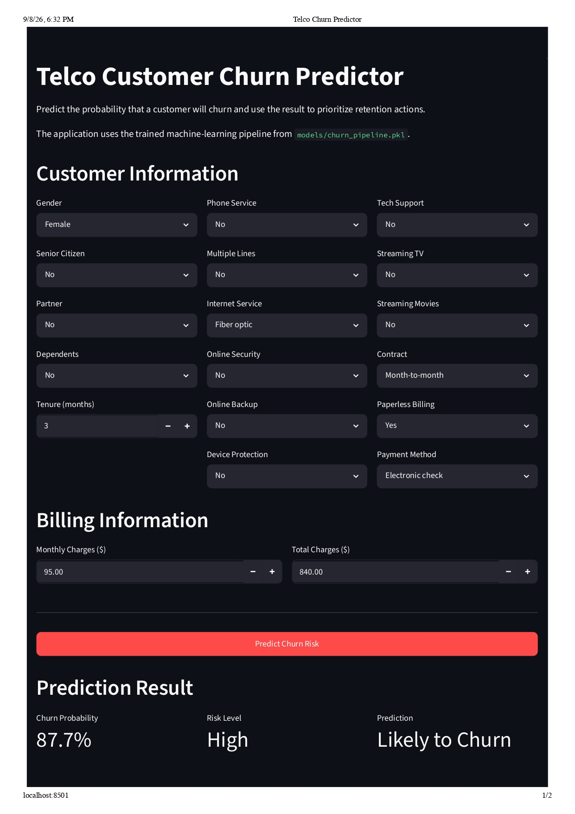
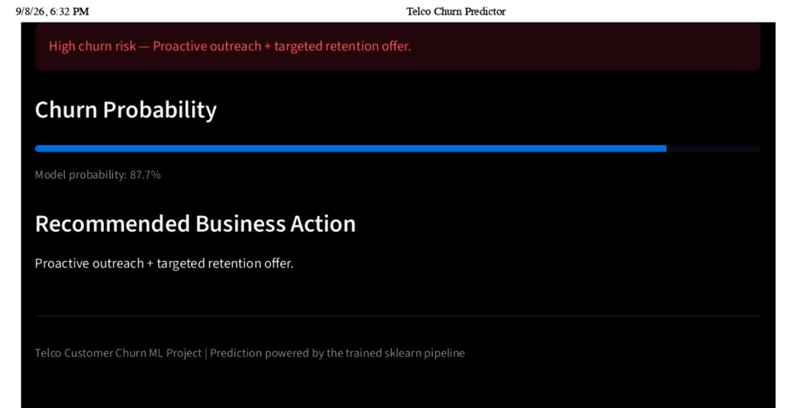

# Telco Customer Churn Prediction

[](https://github.com/shavkatjony/telco-c-classifier-alias/actions/workflows/tests.yml)

An end-to-end machine learning project that predicts customer churn risk and translates model output into practical retention priorities.

**[Live Streamlit App →](https://shavkh.streamlit.app/)**





---

## Results

**Logistic Regression** was selected as the final model after comparing three classification approaches.

| Metric                   |   Test Result |
| ------------------------ | ------------: |
| ROC-AUC                  |     **0.842** |
| Churn Recall             |     **0.791** |
| Churn Precision          |         0.498 |
| True Churners Identified | **296 / 374** |

The model was selected based on **churn detection and overall discrimination rather than accuracy alone**, since missing a likely churner can be more costly in a retention setting.

---

## Business Problem

Customer churn affects recurring revenue and increases customer-acquisition pressure.

This project focuses on three questions:

* Which customers are most likely to churn?
* Which characteristics are associated with higher churn risk?
* How can predictions support a practical retention workflow?

The final application estimates churn probability, assigns a risk level, and provides a retention-oriented action.

---

## Approach

```text
Customer Data
     ↓
Data Cleaning
     ↓
Feature Engineering
     ↓
Train / Test Split
     ↓
Cross-Validation
     ↓
Model Comparison
     ↓
Final Evaluation
     ↓
Saved ML Pipeline
     ↓
Streamlit App + FastAPI Service
```

### Models

* Logistic Regression
* Random Forest
* Gradient Boosting (scikit-learn `HistGradientBoostingClassifier`)

The training workflow (`python -m src.train`) uses stratified splitting and cross-validation. Preprocessing and model inference are kept together in a reusable pipeline.

---

## Model Comparison

Stratified 5-fold cross-validation on the training split (`reports/model_comparison.csv`):

| Model                   |   ROC-AUC | Churn Recall | Precision |    F1 |  Accuracy |
| ----------------------- | --------: | -----------: | --------: | ----: | --------: |
| **Logistic Regression** | **0.846** |    **0.797** |     0.518 | 0.628 |     0.749 |
| Gradient Boosting       |     0.829 |        0.700 |     0.554 | 0.618 |     0.771 |
| Random Forest           |     0.824 |        0.465 |     0.637 | 0.537 | **0.788** |

Random Forest achieved the highest accuracy, but Logistic Regression identified substantially more actual churners. For this use case, recall was therefore a more relevant decision criterion.

---

## Key Findings

The analysis identified several notable churn-risk patterns:

* **Month-to-month contracts** were strongly associated with higher churn.
* **Short-tenure customers** showed substantially higher churn risk.
* Higher-priced **fiber-optic customers** showed elevated churn risk in the analysis.
* **Electronic-check payment** and lower adoption of support/security services were associated with increased churn risk.

These are statistical associations, not evidence of causation.

---

## Application

The Streamlit application provides:

* Customer-level churn prediction
* Churn probability
* Risk classification
* Retention-oriented recommendation

Both the Streamlit app and the API load the trained pipeline from:

```text
models/churn_pipeline.pkl
```

Prediction flow:

```text
Streamlit UI        FastAPI /predict
        ↘            ↙
        src/predict.py
              ↓
    Saved sklearn Pipeline
              ↓
      Churn Probability
              ↓
          Risk Level
              ↓
   Business Recommendation
```

**[Try the live application →](https://shavkh.streamlit.app/)**

### API

`api/main.py` exposes the same inference code over HTTP:

| Endpoint        | Purpose                                                  |
| --------------- | -------------------------------------------------------- |
| `GET /health`   | Liveness check (the model is loaded at startup)          |
| `POST /predict` | One raw customer record → probability, risk band, action |

The request schema is generated from `RAW_INPUT_SCHEMA` in `src/preprocess.py`, the same definition that validates Streamlit input, so the app and the API cannot drift apart. Invalid categories, missing fields and out-of-range numbers return `422`.

Example response:

```json
{
  "churn_prediction": 1,
  "churn_probability": 0.915,
  "risk_band": "High",
  "suggested_action": "Proactive outreach + targeted retention offer."
}
```

Interactive docs with a pre-filled example customer are served at `http://127.0.0.1:8000/docs`.

---

## Dataset

IBM Telco Customer Churn sample dataset (public; a fictional telecom company, commonly distributed via [Kaggle](https://www.kaggle.com/datasets/blastchar/telco-customer-churn)).

| Item          | Value                                      |
| ------------- | ------------------------------------------ |
| Customers     | 7,043                                      |
| Target        | `Churn`                                    |
| Churn Rate    | 26.5%                                      |
| Main Features | Demographics, services, contracts, billing |

A data-quality issue in `TotalCharges` was handled by converting the field to numeric and treating the 11 structural blanks associated with zero-tenure customers as `$0`.

---

## Model Card

| Item           | Detail                                                                                                                                       |
| -------------- | -------------------------------------------------------------------------------------------------------------------------------------------- |
| Model          | Logistic Regression, `class_weight="balanced"`, inside one scikit-learn `Pipeline` (cleaning → scaling / one-hot → model)                    |
| Training data  | IBM Telco sample, stratified 80/20 split (`random_state=42`): 5,634 train / 1,409 test                                                       |
| Selection      | ROC-AUC (ranking quality) with churn recall as the deciding business metric; accuracy is misleading at a 26.5% base rate                     |
| Test result    | ROC-AUC 0.842 · recall 0.791 · precision 0.498 at threshold 0.50                                                                             |
| Intended use   | Ranking existing customers for a retention contact list, where a wasted contact is cheaper than a missed churner                             |

**Threshold.** A customer is flagged `churn_prediction = 1` at a score of 0.50 or higher. At that threshold the model catches 79% of churners, but about half of the flagged customers would have stayed. That trade-off suits a cheap action like an outreach call. It does not suit an expensive one like a large discount. Move the threshold to match retention capacity and offer cost.

**Risk bands.** High (≥ 0.60), Medium (0.35–0.60) and Low (< 0.35) are fixed business heuristics in `src/predict.py`, not values optimised on data. On the test split the observed churn rate was about 56% in High, 26% in Medium and 5% in Low, so the bands do order risk. The binary flag and the bands answer different questions: the flag is the classifier decision the metrics describe, the bands set contact priority.

**Probabilities are scores, not calibrated rates.** Balanced class weights push scores upward: the mean predicted probability on the test split is 0.42 against an actual churn rate of 0.27. Use the output to rank customers. Calibrate it (for example with `CalibratedClassifierCV`) before using it for expected-revenue calculations.

**Do not use it for:**

* Decisions about real customers of a real operator without retraining and validating on that operator's data. The training data is a small, fictional, single-snapshot sample.
* Adverse automated decisions (pricing, credit, service eligibility). It was built only to prioritise retention outreach.
* Causal conclusions such as "adding tech support reduces churn." The coefficients show associations.
* Fairness-sensitive targeting. `gender` and `SeniorCitizen` are model inputs and the model has not been audited for group fairness.

**Other limitations:**

* No monitoring for data drift or performance decay; a production system would need both.
* The notebooks are the exploratory workflow (an earlier unweighted model, including an XGBoost comparison). `reports/threshold_analysis.csv` comes from that notebook model. The deployed pipeline and the numbers on this page come from `python -m src.train`.

---

## Repository

```text
telco-c-classifier/
├── .github/workflows/
│   └── tests.yml          # CI: pytest on every push to main and every PR
├── api/
│   └── main.py            # FastAPI service
├── app/
│   └── streamlit_app.py
├── models/
│   └── churn_pipeline.pkl
├── notebooks/
│   ├── 01_exploration.ipynb
│   ├── 02_preprocessing.ipynb
│   ├── 03_modeling.ipynb
│   └── 04_evaluation.ipynb
├── reports/
│   ├── figures/
│   ├── findings.md
│   ├── final_model_metrics.csv
│   ├── model_comparison.csv
│   └── threshold_analysis.csv
├── src/
│   ├── preprocess.py
│   ├── train.py
│   └── predict.py
├── tests/                 # preprocess, predict and API tests
├── .gitignore
├── pytest.ini
├── requirements.txt       # Streamlit Cloud runtime
├── requirements-dev.txt   # + API, tests, notebooks
└── README.md
```

Raw and generated datasets are excluded from version control. The trained prediction pipeline used by the application is included in the repository, so the tests and CI run without the raw data.

---

## Run Locally

```bash
git clone https://github.com/shavkatjony/telco-c-classifier-alias.git
cd telco-c-classifier-alias

python -m venv .venv
source .venv/bin/activate
```

Streamlit app only (the same dependencies Streamlit Cloud installs):

```bash
python -m pip install -r requirements.txt
streamlit run app/streamlit_app.py
```

The application will normally be available at `http://localhost:8501`.

API, tests and notebooks:

```bash
python -m pip install -r requirements-dev.txt
python -m pytest
uvicorn api.main:app --reload
```

Retrain the model (requires `data/raw/telco_churn.csv`):

```bash
python -m src.train
```

---

## Technology

**Python · pandas · NumPy · scikit-learn · Joblib · Streamlit · FastAPI · pydantic · pytest · GitHub Actions · Jupyter**

---

## Links

**Live Application:** [shavkh.streamlit.app](https://shavkh.streamlit.app/)

**Source Code:** [github.com/shavkatjony/telco-c-classifier-alias](https://github.com/shavkatjony/telco-c-classifier-alias)
